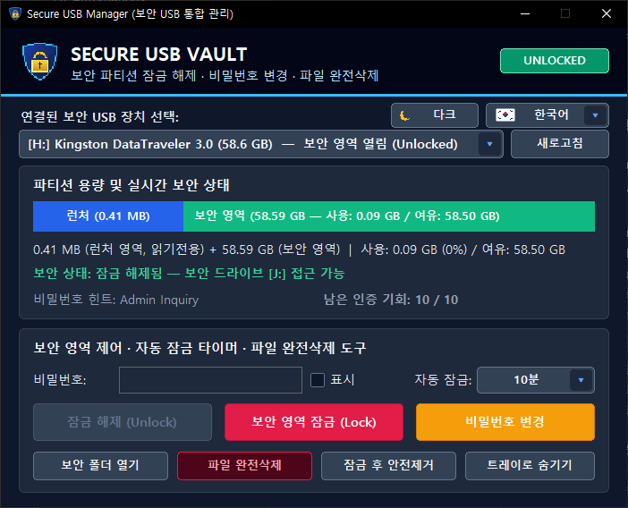

# 🛡️ Secure USB Vault Manager (Pure Rust Win32 Edition)


-DEA584?style=flat-square&logo=rust)


**Secure USB Vault Manager**(`SecureUSBManager.exe`)는 **Innostor `IS918` 시리즈(`IS918M_GA` 등) USB 컨트롤러**의 하드웨어 보안 파티션(Dual-LUN: `CD-ROM + Security`)을 제어하는 초경량 네이티브 보안 런처 및 볼트 관리 프로그램입니다.

기존 제조사 번들 프로그램(`IS918SecurityPack.exe`)의 투박한 UI, 다국어 글자 깨짐, 재포맷 없이는 비밀번호 변경이 불가능했던 한계를 해결하기 위해 **외부 크레이트 의존성 없이(`Zero External Dependencies`) 순수 Rust 표준 라이브러리와 Win32 GDI / SCSI Pass-Through FFI만으로 제작**되었습니다.

<p align="center">
  
</p>

---

## ✨ 주요 특징 (Key Features)

### 1. 🔒 하드웨어 레벨 SCSI 보안 파티션 잠금 / 잠금 해제
- Windows `IOCTL_SCSI_PASS_THROUGH_DIRECT`를 통해 컨트롤러 펌웨어와 직접 통신합니다.
- **32-Round Big-Endian TEA(Tiny Encryption Algorithm)** 및 **1회용 동적 챌린지 토큰(`0xE0 0x32`)** 인증을 통해 하드웨어 보안 영역(`LUN1`)을 마운트하거나 즉시 숨김(Dismount & Lock) 처리합니다.
- 프로그램 종료 시 열려 있는 보안 파티션을 **자동으로 안전하게 잠금** 처리합니다.

### 2. 🔑 포맷 없는 비밀번호 & 힌트 변경 (Portable Vault System)
- 기존 번들 툴에서는 비밀번호를 바꾸려면 MPTool로 USB 전체를 초기화해야 했으나, 본 프로그램은 **순수 Rust로 구현된 SHA-256 솔트 해시 기반 포터블 볼트(`.is918_vault.cfg`)**를 보안 파티션 내부에 동기화하여 **데이터 손실 없이 언제든 비밀번호와 힌트를 변경**할 수 있습니다.
- 설정 정보(변경된 비밀번호 해시, 힌트, 자동 잠금 타이머, 테마)가 **USB 보안 영역 내부에 직접 저장**되므로 다른 PC에 꽂아도 동일한 설정과 비밀번호로 동작합니다.

### 3. 🚨 10회 연속 오류 시 데이터 완전 파기 (Self-Destruct Wipe — Mode B)
- 비밀번호를 틀릴 때마다 남은 인증 기회(`9 / 10` → `1 / 10`)와 데이터 파기 경고 팝업을 표시합니다.
- 남은 기회가 3회 이하일 때는 **`🚨 [위험: 데이터 영구 파기 직전!]`** 강력 경고가 활성화됩니다.
- **10회 연속 인증 실패(`0 / 10`) 시 자폭 프로토콜 작동**:
  1. 보안 영역 내부의 모든 파일을 **3단계 덮어쓰기(`0x00` → `0xFF` → `PRNG 난수`)**로 세단(Shred)
  2. MFT 및 디렉터리 메타데이터 흔적까지 제거하기 위해 볼륨을 **즉시 클린 포맷(`NTFS`)**
  3. 볼트 초기화 후 하드웨어 보안 영역 재잠금

### 4. ⏱️ 자리 비움 자동 잠금 타이머 & 📥 시스템 트레이 상주
- **자동 잠금 타이머 (`사용 안 함` / `5분` / `10분` / `15분` / `30분`)**: 지정된 시간 동안 마우스·키보드 입력이 없으면 보안 영역을 자동으로 잠그고 트레이 알림을 띄웁니다.
- **시스템 트레이(System Tray) 지원**: 창을 최소화(`_`)하거나 `[트레이로 숨기기]`를 누르면 시계 옆 트레이 아이콘으로 상주하며, 우클릭 메뉴로 **`보안 폴더 열기`**, **`즉시 잠금`**, **`잠금 후 안전 제거`**를 바로 실행할 수 있습니다.

### 5. 🛡️ 파일 완전 삭제(3-Pass 보안 세단기) & 잠금 후 안전 제거
- **`[파일 완전삭제]`**: 선택한 중요 파일을 DoD 방식 3단계 덮어쓰기 후 삭제하여 포렌식/복구 프로그램으로도 절대 복원할 수 없게 파기합니다.
- **`[잠금 후 안전제거]`**: 파일시스템 캐시 플러시 → 볼륨 잠금 및 마운트 해제 → 하드웨어 보안 잠금(`0xE0 0x33 0x11`) → 미디어 추출(`IOCTL_STORAGE_EJECT_MEDIA`)을 원클릭으로 수행합니다.

### 6. 🌓 라이트 / 다크 모드 & 🌐 3개 국어(KO / EN / JA) 완벽 지원
- **라이트 / 다크 모드**: Windows 시스템 테마를 자동 감지하며, 상단 **`☀️ 라이트` / `🌙 다크`** 버튼으로 타이틀 바(`DwmSetWindowAttribute`)부터 캔버스·입력창·버튼까지 즉시 전환됩니다.
- **다국어 지원**: **한국어(`한국어`) · 영어(`English`) · 일본어(`日本語`)** 실시간 전환 및 GDI 벡터 그래픽으로 직접 렌더링한 국기 아이콘(태극기 / 성조기 / 일장기)을 제공합니다.
- **High-DPI (`PerMonitorV2`) & 더블 버퍼링**: 4K/고해상도 모니터에서도 글자 깨짐이나 깜빡임이 없으며, 약 **`345 KB` 단일 네이티브 실행 파일**로 `.NET`이나 `VC++ 재배포 패키지` 설치 없이 모든 Windows PC에서 즉시 실행됩니다.

---

## 🖥️ UI 및 파티션 구조 (Dual-LUN Architecture)

USB는 컨트롤러 레벨에서 다음과 같이 2개의 독립 LUN으로 분할되어 동작합니다:

| 구분 | 역할 | 파일시스템 / 크기 | 특징 |
| :--- | :--- | :--- | :--- |
| **`LUN 0`** | 가상 CD-ROM 런처 영역 | `ISO9660 + Joliet` (~`424 KB`) | 하드웨어 읽기 전용(변조 및 바이러스 감염 원천 차단), `SecureUSBManager.exe` 내장 |
| **`LUN 1`** | 하드웨어 보안 데이터 영역 | `NTFS` / `exFAT` (나머지 전체 용량, 예: `58.59 GB`) | 잠금 시 디스크 관리에서도 용량이 `0`으로 숨겨지며, 비밀번호 인증 시에만 마운트 및 실사용량 표시 |

---

## 🚀 빌드 및 실행 방법 (Build & Usage)

### 1. Rust 네이티브 빌드
외부 크레이트(Cargo 패키지) 의존성이 전혀 없으므로(`Cargo.toml` 내 `[dependencies]` 없음) 인터넷 연결 없이 표준 Rust 툴체인만으로 즉시 빌드됩니다.

```powershell
cd rust_secure_usb
cargo build --release
```
- 빌드 결과물: `rust_secure_usb/target/release/secure_usb_manager.exe`

### 2. CLI(명령줄) 모드 사용법
GUI뿐만 아니라 스크립트 자동화를 위한 CLI 명령도 내장되어 있습니다.

```powershell
# 현재 보안 USB 상태 및 파티션/실사용 용량 확인
SecureUSBManager.exe status

# 보안 영역 잠금 해제
SecureUSBManager.exe unlock <비밀번호>

# 보안 영역 즉시 잠금
SecureUSBManager.exe lock

# 보안 영역 잠금 후 안전 제거(Safe Eject)
SecureUSBManager.exe eject

# 비밀번호 및 힌트 변경
SecureUSBManager.exe passwd <현재_비밀번호> <새_비밀번호> [새_힌트]
```

### 3. CD-ROM 런처 ISO 이미지(`secure_launcher.iso`) 생성 및 MPTool 탑재
1. `preload_lun0/` 폴더 안에 빌드된 `SecureUSBManager.exe`, `logo.ico`, `autorun.inf`를 배치합니다.
2. Windows 내장 `IMAPI2FS`를 이용해 `secure_launcher.iso` 이미지를 생성합니다.
3. `IS918MPTool`의 `Configuration/MPTool.ini`에서 아래와 같이 설정한 후 **`Start`**를 누르면 하드웨어 CD-ROM(`LUN0`)에 런처가 영구 탑재됩니다:
   ```ini
   [Partition]
   PartitionNum=2
   PartitionType=5
   Lun0SizeRatio=0
   Lun1SizeRatio=100
   Lun0CDROMPath=...\secure_launcher.iso
   NoPWDPwrOnLogin=1
   PwdRetryTimes=10
   ```

---

## 🔬 IS918 하드웨어 보안 SCSI 프로토콜 요약 (Reverse-Engineered Spec)

본 프로젝트에서 분석 및 검증한 Innostor `IS918` 컨트롤러의 Vendor-Specific SCSI 명령 규격입니다:

| 기능 | SCSI CDB (10 Bytes) | 방향 / 길이 | 설명 |
| :--- | :--- | :--- | :--- |
| **컨트롤러 식별** | `12 00 00 00 60 00 00 00 00 00` | `DATA_IN` (`96B`) | 표준 `INQUIRY`. 오프셋 `40..44` 바이트가 `"BWSE"` 시그니처인지 확인 |
| **Flash ID 조회** | `E0 10 06 90 00 0E 00 00 00 00` | `DATA_IN` (`512B`) | 오프셋 `0..6` 바이트에 NAND Flash 고유 ID 반환 |
| **파티션 테이블 조회** | `E0 30 00 00 00 00 00 00 01 00` | `DATA_IN` (`512B`) | 오프셋 `0x10 + i*4`에 Big-Endian `u32` 섹터 수, `0x30 + i`에 LUN 속성 플래그 반환 |
| **보안 상태/토큰 조회** | `E0 32 00 00 00 00 00 01 06 00` | `DATA_IN` (`48B` / `0x30`) | **[주의]** 길이는 반드시 `0x30`이어야 함.<br>`buf[0]`: 1회용 동적 챌린지 토큰<br>`buf[1]`: 남은 재시도 횟수<br>`buf[2] & 1`: 잠금 해제 여부 (`1`=열림, `0`=잠김)<br>`buf[15]`: 최대 재시도 제한<br>`buf[32..48]`: ASCII 비밀번호 힌트 |
| **하드웨어 잠금 해제** | `E0 33 00 01 00 00 00 01 00 00` | `DATA_OUT` (`512B`) | 직전 `0xE0 0x32` 호출에서 받은 `buf[0]` 토큰으로 128-bit TEA 키 `[token + 0x266EC300, 0x36D9C77D, 0xE48D5124, 0xAD7275C8]`를 구성하여 16바이트 비밀번호(`plain32[0..16]`)를 32라운드 암호화한 뒤 전송 |
| **하드웨어 즉시 잠금** | `E0 33 11 00 00 00 00 00 01 00` | `UNSPECIFIED` (`0B`) | 볼륨 `FSCTL_LOCK_VOLUME` 및 `FSCTL_DISMOUNT_VOLUME` 후 전송 시 즉시 하드웨어 잠금 |

---

## 📂 디렉터리 구조 (Repository Structure)

```text
├── README.md                       # 프로젝트 문서 (본 파일)
├── preview.png                     # 프로그램 실행 화면 미리보기 스크린샷
├── .gitignore                      # Git 제외 파일 설정
├── secure_shield.ico               # 멀티 해상도(16/32/48px) 커스텀 방패 아이콘
├── SecureUSBManager.exe            # 최신 빌드된 Rust 네이티브 실행 파일 (~345 KB)
├── secure_launcher.iso             # MPTool 탑재용 CD-ROM(LUN0) ISO 이미지 (~424 KB)
├── rust_secure_usb/                # 순수 Rust 네이티브 Win32 프로젝트
│   ├── Cargo.toml                  # 외부 의존성 0개, 최소 크기(opt-level="z", LTO) 설정
│   ├── build.rs                    # Windows RC 리소스(아이콘/매니페스트/버전정보) 컴파일러
│   ├── app.rc                      # PerMonitorV2 DPI 매니페스트 및 다국어 VERSIONINFO
│   └── src/
│       └── main.rs                 # SCSI 엔진, TEA/SHA-256, GDI 더블버퍼링 UI, 세단기 전체 구현
└── preload_lun0/                   # USB 가상 CD-ROM(LUN0) ISO 원본 폴더
    ├── SecureUSBManager.exe        # CD-ROM 내장 실행 파일
    ├── logo.ico                    # 드라이브 아이콘
    └── autorun.inf                 # CD-ROM 볼륨 아이콘 및 자동실행 정의
```

---

## 📜 라이선스 (License)

This project is licensed under the **MIT License**.
